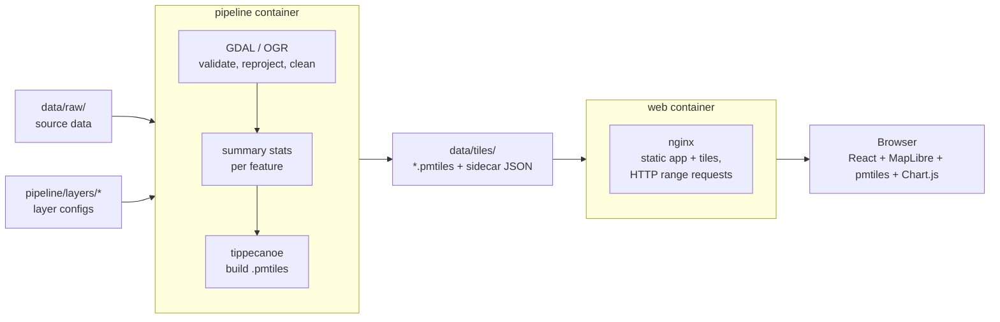

# 01 Architecture

## Overview



Two containers share one folder. The pipeline writes to `data/tiles/`; the web
container serves it read-only. Neither container talks to the other at
runtime.

## Repo layout (planned)

```text
pipeline/
  Dockerfile          GDAL base image plus tippecanoe and pmtiles CLI
  bin/run.sh          entry point: runs every layer, or the ones named
  lib/*.sh            shared functions (logging, ogr helpers, tile build)
  layers/<name>.env   one config per layer: input, filters, tippecanoe flags
  tests/              bats tests; fixtures/ holds the synthetic CI test case
web/
  Dockerfile          multi-stage: node build, then nginx runtime
  nginx.conf          serves the app and /tiles/ with range requests
  package.json
  src/
    map/              MapLibre setup, pmtiles protocol, layer registry
    layers/           per-layer style and pop-up definitions
    popup/            pop-up components and Chart.js charts
data/                 never committed (only .gitkeep files)
  raw/                pipeline input
  tiles/              pipeline output, served by web
docker-compose.yml
```

Layering rule: the web app reads only what is in `data/tiles/` and the data
contract in `02_data_layers_and_popups.md`. It never reads `data/raw/`.

## Pipeline

- Base image: `ghcr.io/osgeo/gdal` (ubuntu-small variant, pinned tag), with
  tippecanoe (felt/tippecanoe) built from a pinned release tag and the
  `pmtiles` CLI (protomaps/go-pmtiles) from a pinned release binary.
- Scripts are bash with `set -euo pipefail`, linted with shellcheck and
  tested with bats.
- Per layer, the steps are:
  1. Validate and normalise the input with `ogr2ogr` (reproject to
     EPSG:4326, fix geometries, select and rename attributes) into an
     intermediate GeoJSONSeq or FlatGeobuf in a scratch folder.
  2. Compute summary stats (with OGR SQL or a small helper; TBC once the stats
     are known) and either join them as attributes or write sidecar JSON.
  3. Run tippecanoe with the layer's flags to write
     `data/tiles/<layer>.pmtiles` directly.
  4. Write a `data/tiles/manifest.json` listing the layers built, their
     bounds, zoom range, and build time, which the web app can read.
- Builds write to a temp file and move it into place at the end, so a failed
  run never leaves a half-written `.pmtiles` that the web app would serve.
- `mb-util` is not installed until a step needs it (see the brief's open
  questions).

## Web app

- React and TypeScript, built with Vite.
- MapLibre GL JS for the map, with the `pmtiles` JS library registered as a
  protocol so sources use `pmtiles://` URLs pointing at `/tiles/<layer>.pmtiles`.
- Each layer is described in one place in `src/layers/` (source, style
  layers, pop-up definition) so adding a layer does not mean touching the map
  setup.
- On click, the app queries rendered features, then builds the pop-up from
  the feature's attributes (and sidecar JSON, if used). Pop-up content is a
  React component rendered into the MapLibre popup's container.
- Chart.js renders the charts, drawn on a canvas inside the pop-up. Register
  only the chart types and components used (tree-shaken imports) to keep the
  bundle small, and destroy each chart instance when its pop-up closes.
- Basemap: CARTO Positron by default, Dark Matter as a toggle (ADR 0005),
  behind one module in `src/map/`. The CARTO API key is read at runtime from
  `/config.json`, never baked into the build. With no key, the app uses
  OpenFreeMap's keyless Positron and Dark styles and logs a warning. In
  development the Vite dev server serves `/config.json` from `CARTO_API_KEY`
  (the environment, or the repo root `.env`).
- Tests: vitest for logic (stat formatting, layer registry), ESLint and
  `tsc --noEmit` as gates.

## Docker Compose

The root `docker-compose.yml` (project name `erap-map`) builds two local
images from the Docker Hub org `natureconservancy`:
`natureconservancy/erap-map-web` and `natureconservancy/erap-map-pipeline`.
They are not pushed yet; that is a separate issue. Every variable has a
default, so the git-ignored `.env` (documented in `.env.example`) is
optional.

- `web`: builds `web/Dockerfile`, publishes `${WEB_PORT:-8080}:8080`,
  mounts `./data/tiles` read-only at `/srv/tiles` (served at `/tiles/`),
  and passes `CARTO_API_KEY` from `.env` (empty when unset). At start an
  entrypoint script (`web/docker/40-write-config-json.sh`) writes it,
  JSON-escaped, to `/tmp/erap-web/config.json`, which nginx serves as
  `/config.json`. A plain envsubst template is not used because it would not
  escape the value; a key with control characters stops the container.
  Runs with `read_only: true` and a tmpfs on `/tmp`, a healthcheck with the
  image's busybox `wget`, and `restart: unless-stopped`. Started with
  `docker compose up -d web`.
- `pipeline`: builds the `runtime` target of `pipeline/Dockerfile`, mounts
  `./data/raw` read-only and `./data/tiles` read-write, under the `pipeline`
  profile so `docker compose up` does not start it. Run on demand with
  `docker compose run --rm pipeline [layer ...]`. It runs as
  `${PIPELINE_UID:-10001}:${PIPELINE_GID:-10001}`; on Linux set both to the
  host user so the tiles are owned by them. Docker Desktop needs nothing.
- `web-dev` (profile `dev`): the frontend dev workflow, decided in M1 as a
  compose service rather than `npm run dev` on the host, so only Docker is
  needed (ADR 0004). It runs Vite with hot reload in the same pinned Node
  image the web build uses, with `./web` bind-mounted at `/repo/web`, its
  Linux `node_modules` in the named volume `web-dev-node-modules` (`npm ci`
  only when `package-lock.json` changed), and `./data/tiles` read-only at
  `/repo/data/tiles`, where `vite.config.ts` looks by default. Port
  `${WEB_DEV_PORT:-5173}`; `CARTO_API_KEY` is passed through to the dev
  server's `/config.json`. File events do not reach the container from
  Windows bind mounts, so `VITE_USE_POLLING` (default 1) turns on Vite's
  polling watcher. `npm run dev` on the host still works for anyone with
  Node 26.

## Serving PMTiles

nginx serves static files with byte-range support by default, which is all
PMTiles needs. Set correct `Content-Type` for `.pmtiles`
(`application/vnd.pmtiles`) and allow caching with revalidation so a rebuilt
layer is picked up. If the app is ever hosted elsewhere, any static host or
object store that supports range requests (and CORS, if on another origin)
will do.
