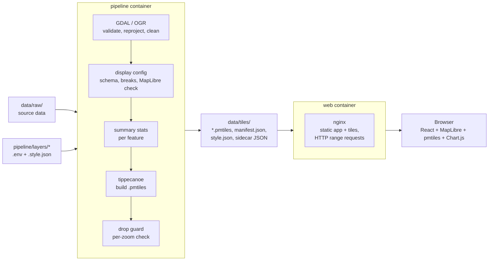

# 01 Architecture

## Overview



Two containers share one folder. The pipeline writes to `data/tiles/`; the web
container serves it read-only. Neither container talks to the other at
runtime.

## Repo layout (planned)

```text
pipeline/
  Dockerfile          GDAL base image plus tippecanoe, pmtiles CLI and Node
  bin/run.sh          entry point: runs every layer, or the ones named
  lib/*.sh            shared functions (logging, ogr helpers, tile build,
                      raster tiles)
  layers/<name>.env   one config per layer: type (vector or raster), input,
                      filters, tippecanoe flags
  layers/<name>.style.json
                      display per layer: title, style, legend, pop-up (ADR 0007)
  schema/             JSON Schema of the .style.json files, shared with web/
  style/              Node tool: validates and resolves the display configs
  tests/              bats tests; fixtures/ holds the synthetic CI test case
web/
  Dockerfile          multi-stage: node build, then nginx runtime
  nginx.conf          serves the app and /tiles/ with range requests
  package.json
  src/
    map/              MapLibre setup, pmtiles protocol, layer panel
    layers/           manifest.json reader, style layer wiring, visibility
    popup/            pop-up components and Chart.js charts
data/                 never committed (only .gitkeep files)
  raw/                pipeline input
  tiles/              pipeline output, served by web
  work/               scratch for manual trials (git-ignored)
docker-compose.yml
```

Layering rule: the web app reads only what is in `data/tiles/` and the data
contract in `02_data_layers_and_popups.md`. It never reads `data/raw/`.

## Pipeline

- Base image: `ghcr.io/osgeo/gdal` (ubuntu-small variant, pinned tag), with
  tippecanoe (felt/tippecanoe) built from a pinned release tag and the
  `pmtiles` CLI (protomaps/go-pmtiles) from a pinned release binary, plus
  Node (from the same pinned image as the web build) for the display config
  tool in `pipeline/style/` (ADR 0007).
- Scripts are bash with `set -euo pipefail`, linted with shellcheck and
  tested with bats.
- Per layer, the steps are:
  1. Validate and normalise the input with `ogr2ogr` (reproject to
     EPSG:4326, fix geometries, select and rename attributes) into an
     intermediate GeoJSONSeq in a scratch folder. Shapefiles without a
     `.prj` or `.cpg` get a per-layer source CRS or encoding, and `.zip`
     inputs are read in place through `/vsizip/` (see 02). No
     simplification here: `ogr2ogr -simplify` works per feature and would
     open gaps between neighbours.
  2. Check and resolve the layer's display config,
     `pipeline/layers/<layer>.style.json` (ADR 0007, `lib/display.sh`):
     the JSON Schema in `pipeline/schema/`, `breaks` computed from the
     normalised data, the `symbology` shorthand expanded into MapLibre style
     layers, the legend derived or taken from the config, and the MapLibre
     style validator on the result. Any problem fails the layer here, before
     tiling, so the previous archive and manifest entry stay.
  3. Compute summary stats (with OGR SQL or a small helper; TBC once the stats
     are known) and either join them as attributes or write sidecar JSON.
  4. Measure each feature once for the drop guard: the area of its largest
     polygon part in EPSG:3857 (`gdal vector pipeline`, `lib/guard.sh`).
  5. Run tippecanoe with the layer's profile and flags (for example
     `LAYER_PROFILE=coverage` for contiguous polygon coverages; see 02),
     reading the GeoJSONSeq in parallel (`--read-parallel`), into a temp
     archive.
  6. Drop guard: read the archive zoom by zoom (GDAL's PMTiles driver, feature
     ids only) and fail the build if any feature big enough to see at a zoom
     (`LAYER_MIN_VISIBLE_PX`, default 1 screen pixel at 256 px tiles) is
     missing there. Smaller missing features are only logged.
  7. Move the archive to `data/tiles/<layer>.pmtiles` and write a
     `data/tiles/manifest.json` listing the layers built, their bounds, zoom
     range, build time, resolved `display` config and per-zoom stats, which
     the web app reads at startup.
- A raster layer (`LAYER_TYPE=raster`, a binary raster, display only; ADR
  0008, `lib/raster.sh`) takes its own branch after step 2: gdalwarp to
  EPSG:3857 at the max zoom's resolution, the share of each pixel covered
  averaged per lower zoom, grey PNG tiles by `gdal raster tile` per zoom,
  packed with `sqlite3` into MBTiles and `pmtiles convert` into the
  archive. The colour is applied in the map (a `raster-dem` source and a
  `color-relief` layer), not baked into the tiles.
- After all layers, `data/tiles/style.json` is rewritten from the manifest:
  a standalone MapLibre style of every built layer (no basemap) for other
  tools.
- Builds write to a temp file and move it into place at the end, so a failed
  run (including a failed drop guard) never leaves a half-written or
  failed `.pmtiles` that the web app would serve.
- `mb-util` is not installed until a step needs it (see the brief's open
  questions).

## Web app

- React and TypeScript, built with Vite.
- MapLibre GL JS for the map, with the `pmtiles` JS library registered as a
  protocol so sources use `pmtiles://` URLs pointing at `/tiles/<layer>.pmtiles`.
- No layer is defined in the app (ADR 0007). At startup it fetches
  `tiles/manifest.json` (no-cache) and builds the layer list, style layers,
  legends, pop-ups and draw order from each entry's `display` block
  (`src/layers/manifest.ts`), checked against the same rules as the shared
  schema. Adding or restyling a layer is a pipeline change only. A missing
  or invalid manifest leaves the basemap up with a message in the layer
  panel; a layer whose archive cannot be read is listed but disabled.
- On click, the app queries rendered features, then builds the pop-up from
  the feature's attributes (and sidecar JSON, if used). Pop-up content is a
  React component rendered into the MapLibre popup's container.
- Chart.js renders the charts, drawn on a canvas inside the pop-up. Register
  only the chart types and components used (tree-shaken imports) to keep the
  bundle small, and destroy each chart instance when its pop-up closes.
- Basemap: OpenFreeMap's keyless Positron by default, Dark as a toggle
  (ADR 0006), behind one module in `src/map/basemap.ts`. No key and no
  runtime config: the map is created straight away with the light style.
  MapLibre's attribution control stays on.
- Tests: vitest for logic (stat formatting, manifest reading, the checks
  kept in step with the shared schema), ESLint and `tsc --noEmit` as gates.

## Docker Compose

The root `docker-compose.yml` (project name `erap-map`) builds two local
images from the Docker Hub org `natureconservancy`:
`natureconservancy/erap-map-web` and `natureconservancy/erap-map-pipeline`.
They are not pushed yet; that is a separate issue. Every variable has a
default, so the git-ignored `.env` (documented in `.env.example`) is
optional.

- `web`: builds `web/Dockerfile`, publishes `${WEB_PORT:-8080}:8080`,
  mounts `./data/tiles` read-only at `/srv/tiles` (served at `/tiles/`).
  Runs with `read_only: true` and a tmpfs on `/tmp` (nginx's pid file and
  temp files), a healthcheck that fetches `/` with the image's busybox
  `wget`, and `restart: unless-stopped`. Started with
  `docker compose up -d web`.
- `pipeline`: builds the `runtime` target of `pipeline/Dockerfile`, mounts
  `${RAW_DIR:-./data/raw}` read-only at `/data/raw` (`RAW_DIR` points it at
  source data outside the repo), `./data/tiles` read-write and `./pipeline/layers`
  read-only over the image's copy (so editing a layer's `.env` or
  `.style.json` needs no image rebuild), under the `pipeline` profile so
  `docker compose up` does not start it. Run on demand with
  `docker compose run --rm pipeline [layer ...]`. It runs as
  `${PIPELINE_UID:-10001}:${PIPELINE_GID:-10001}`; on Linux set both to the
  host user so the tiles are owned by them. Docker Desktop needs nothing.
- `web-dev` (profile `dev`): the frontend dev workflow, decided in M1 as a
  compose service rather than `npm run dev` on the host, so only Docker is
  needed (ADR 0004). It runs Vite with hot reload in the same pinned Node
  image the web build uses, with `./web` bind-mounted at `/repo/web`, its
  Linux `node_modules` in the named volume `web-dev-node-modules` (`npm ci`
  only when `package-lock.json` changed), and `./data/tiles` read-only at
  `/repo/data/tiles`, where `vite.config.ts` looks by default. Port
  `${WEB_DEV_PORT:-5173}`. File events do not reach the container from
  Windows bind mounts, so `VITE_USE_POLLING` (default 1) turns on Vite's
  polling watcher. `npm run dev` on the host still works for anyone with
  Node 26.

## Serving PMTiles

nginx serves static files with byte-range support by default, which is all
PMTiles needs. Set correct `Content-Type` for `.pmtiles`
(`application/vnd.pmtiles`) and allow caching with revalidation so a rebuilt
layer is picked up. If the app is ever hosted elsewhere, any static host or
object store that supports range requests (and CORS, if on another origin)
will do.
