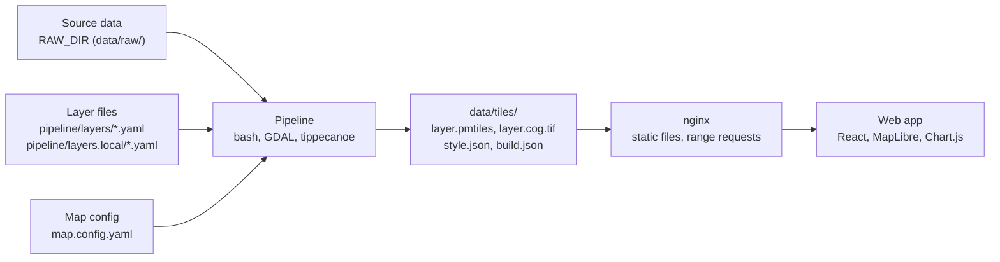

# How it works

The map has two parts that share only a folder of files. The pipeline
turns source data into static files in `data/tiles/`; the web app reads
those files in the browser. There is no tile server or database.

## Inputs

- **Source data**: anything GDAL opens (shapefile, zipped shapefile,
  GeoPackage, GeoJSON, file geodatabase), or a binary GeoTIFF (0, 1 and
  nodata). It stays outside the repo, in the folder `RAW_DIR` names in
  `.env` (default `data/raw/`), mounted read-only.
- **Layer files**: one `<layer>.yaml` per layer in `pipeline/layers/`
  (committed) or `pipeline/layers.local/` (your own, git-ignored). Each
  says where the data comes from (`source`), which attributes to keep or
  calculate (`fields`), how to tile it (`processing`) and how to draw it
  and what a click shows (`display`). See [layer-file.md](layer-file.md).
- **Map config** (optional): your git-ignored `map.config.yaml` picks the
  layers to build, overrides a layer's source or processing, and sets the
  opening view, basemap, page title and number locale. The GitHub Pages
  copy uses the committed `map.pages.yaml`.

## Pipeline steps

`docker compose run --rm pipeline [layer ...]` runs `pipeline/bin/run.sh`.
For each layer:

1. **Read and check the layer file** against
   `pipeline/schema/layer.schema.json`, with the map config's overrides
   applied, then the checks a schema cannot make. A layer with problems
   is `invalid` and is not built; the others still are.
2. **Read the source** with `ogr2ogr`: reproject to EPSG:4326, make
   geometries valid, add the attributes of any `source.joins` tables,
   keep and rename the attributes in `fields.keep`, then add the
   `fields.calculated` SQLite expressions.
3. **Tile** a vector layer with tippecanoe, using the options of its
   profile (`default`, `coverage` or `points`). A polygon layer is
   generalised zoom by zoom first, max zoom included, more gently there
   (ADR 0016; as a coverage for `coverage`). The drop guard then checks
   no visible polygon was lost, and the archive is moved into place.
4. **Or warp** a raster layer (profile `raster`) with GDAL into one Web
   Mercator COG, whose pixels are the share covered (0 to 255), with an
   overview per zoom: `gdalwarp`, then `gdal_translate -of COG` on the
   `GoogleMapsCompatible` tiling scheme with average overviews. The
   source is first rewritten once as a tiled file, cached in
   `data/work/`.
5. **Record** the build in `build.json` (counts, sizes, drops, zooms,
   the source path, and the build hash and time that `--status` compares
   with the layer file and the source files' times to spot stale builds).
6. **Write `style.json`** from every built layer's `display`.

Each file is written to a temporary name and moved into place, so the
map never sees a half-written file, and a failed build keeps the
previous one.

## Outputs

| File | Read by | What |
| --- | --- | --- |
| `<layer>.pmtiles` | app | vector tiles of one layer, in a PMTiles archive |
| `<layer>.cog.tif` | app | one raster layer, a Cloud Optimized GeoTIFF |
| `style.json` | app | a MapLibre style of the data layers, with `erap:` metadata |
| `build.json` | `--status`, `scripts/` | the build report |

`style.json` is a standard MapLibre style (version 8). Its sources are
relative `pmtiles://` and `cog://` URLs, and its style layers are the
layer files' `display.layers` with a `<layer>-` id prefix. What MapLibre
does not know about is in `metadata`:

- `erap:layers`: per layer, its title, type, order, visibility, legend,
  colour themes and pop-up.
- `erap:basemap`, `erap:view` (zoom limits and bounds; the max zoom is
  the layers' highest unless the map config sets one), `erap:title` and
  `erap:locale`, from the map config; the opening view is the style's
  `center` and `zoom`.

## Web app

nginx serves the built app and `data/tiles/` at `/tiles/`, with range
requests, so the browser fetches only the parts of each archive it needs.
The app:

1. Loads the basemap (OpenFreeMap Light or Dark, ADR 0006).
2. Fetches `tiles/style.json`, checks it is a version 8 style, and adds
   each layer's sources and style layers on top, in draw order.
3. Lists the layers in the panel, with a legend built from each colour
   expression (or the layer's own `legend`) and a "Colour by" choice for
   layers with themes.
4. On a click, fills the layer's pop-up from the feature's tile
   attributes: a small pop-up at the click, or a dialog with tabs. Charts
   are drawn with Chart.js.

A layer whose archive cannot be read shows as not available in the
panel; the others still draw. The app reads nothing but `style.json` and
the archives, so a rebuilt layer shows on a page reload.

## The GitHub Pages copy

`docker compose run --rm pipeline-pages` runs the same pipeline with
`map.pages.yaml` (lower zooms, a public source for protected areas) into
`data/pages/`. `scripts/publish-pages.sh` uploads those files to a GitHub
release and runs a workflow that builds the app and serves it with them
(ADR 0014). See [guide.md](guide.md#publish-the-github-pages-copy).

## Where to read more

- [guide.md](guide.md): each task as plain commands.
- [layer-file.md](layer-file.md): every key of a layer file and the map
  config.
- `pipeline/README.md`, `scripts/README.md`, `web/README.md`: the code.
- `docs/decisions/`: why things are as they are.
